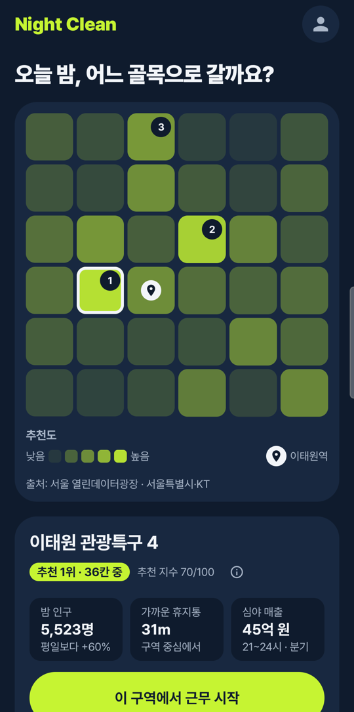
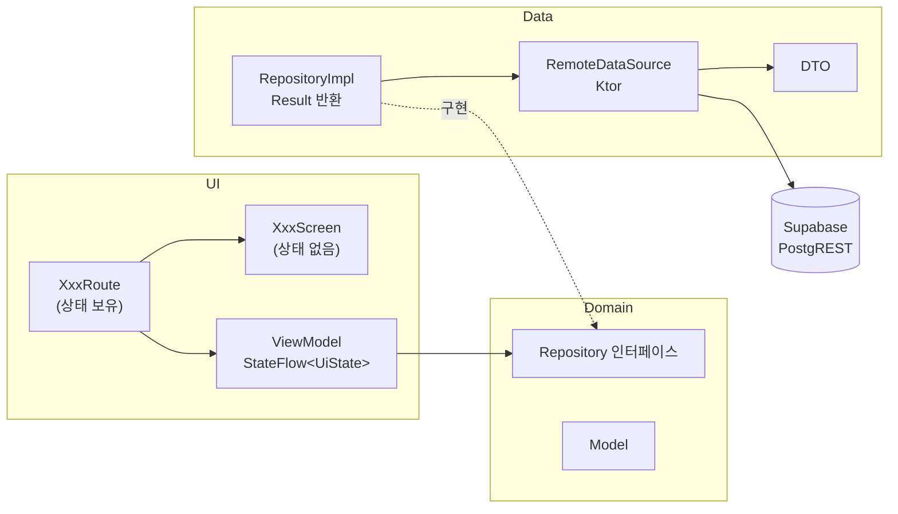

# 야간 클린 워커 (NightClean)

상권 골목의 야간 청소 인력이 가게 광고를 단 조끼를 입고 거리를 청소하면서, 지나가는 사람들에게 가게를 안내하는 서비스입니다.
청소 인력의 인건비는 가게 광고비와 서울시의 수거량 보상으로 나눠 부담합니다.

> 2026 서울 야간경제 활성화 해커톤 출품작. 이태원 5개 가게 대상 시범 운영을 준비하고 있습니다.

## 해결하려는 문제

서울시와 자치구는 야간 청결에 돈과 인력을 더 쓰고 있지만, 대응은 쓰레기통과 수거 횟수를 늘리는 데 머물러 있습니다.

- **쓰레기통 딜레마**: 서울 가로쓰레기통은 1995년 7,607대에서 2007년 3,707대로 줄었다가 다시 늘리고 있습니다. 하지만 "없으면 길거리 투기, 만들면 얌체 투기"라는 딜레마가 남아 있습니다. ([서울시](https://news.seoul.go.kr/env/archives/507323), [MBC 2025.2.10](https://imnews.imbc.com/replay/2025/nwdesk/article/6685269_36799.html))
- **야간 청결이 정책 과제로**: 서울형 야간경제 대책(2026.8)은 야간 유동 인구가 많은 지역에 청결기동대를 투입합니다. 보도 기준 150명입니다. ([내 손안에 서울 2026.8.20](https://mediahub.seoul.go.kr/archives/2019126), [뉴스핌 2026.8.20](https://www.newspim.com/news/view/20260820000601))
- **수거 횟수 늘리기**: 마포구는 홍대 레드로드의 수거를 주 5일 야간에서 주 7일 주야간으로 늘렸습니다. ([헤럴드경제 미주판 2026.4.21](https://www.heraldk.com/article/2026042113400052188))
- **처리비 증가**: 2026년부터 수도권 생활폐기물 직매립이 금지되어 자치구의 처리 비용 부담이 커지고 있습니다. ([서울시 2025.12](https://news.seoul.go.kr/env/archives/566522))

이 서비스는 쓰레기통을 늘리는 대신 사람이 골목을 돌며 치우게 합니다. 청소 인력은 걸어 다니는 광고판이 되어, 큰길에서 잘 보이지 않는 골목 안쪽 가게로 손님을 안내합니다. 비용은 광고를 다는 가게와 수거량에 따라 보상하는 시가 나눠 냅니다.

> 야간 상권만 따로 집계한 쓰레기 통계는 공개된 것이 없습니다. 이태원 시범 운영의 실측값과 정보공개 청구 결과로 보완할 예정입니다.

## 주요 화면

| 구역 지도 |
|---|
|  |

| 화면 | 역할 | 상태 |
|---|---|---|
| 로그인 | 운영자가 발급한 계정으로 로그인, 워커·상인 역할별 첫 화면 | 구현 (Supabase Auth) |
| 구역 지도 | 250m 격자별 배치 추천도를 보고 근무 구역 선택 | 구현 (Supabase 연동) |
| 근무 중 | 근무 시간, 광고 슬롯, 청소 전 사진, 이동 경로 기록, 체크인 수, 봉투 수, 긴급 연락 | 구현 (동의 후 근무 중에만 GPS 기록) |
| 가게 체크인 | QR 스캔과 가게 반경 50m 확인 | 구현 (서버에서 거리 판정) |
| 근무 종료 | 봉투 수, 사진, 청소 후 사진, 무게(저울이 있을 때만), 예상 수입 입력 | 구현 |
| 상인 리포트 | 가게별 월간 지표, 안내받고 온 손님 기록, 청소 전후 사진 | 일부 구현 (광고 노출·QR 스캔 수 제외) |
| QR 랜딩 (시민용 웹) | 홍보물 QR로 들어온 시민에게 가게 안내, 혜택, 청결도 평가 | 구현 (`web/`, GitHub Pages) |

## 구조



- **화면 분리**: `XxxRoute`는 ViewModel을 받아 상태와 이벤트만 넘기고, `XxxScreen`은 상태를 갖지 않습니다. 그래서 Preview와 UI 테스트는 `XxxScreen`만으로 할 수 있습니다.
- **UseCase 계층 없음**: 지금은 Repository 호출을 그대로 전달하는 일밖에 없습니다. 여러 Repository를 조합해야 할 때 UseCase를 추가합니다.
- **오류 처리**: Repository는 Kotlin `Result`를 돌려주고, 코루틴 취소(`CancellationException`)는 잡지 않고 다시 던집니다. 화면에는 예외 원문 대신 고정된 한글 안내 문구를 보여줍니다.
- **임시 처리 표시**: 의도적으로 단순하게 만든 부분에는 `// shortcut:` 주석으로 한계와 바꿀 시점을 적어 둡니다.

## 기술 스택

| 영역 | 사용 기술 | 선택 이유 |
|---|---|---|
| UI | Jetpack Compose, Material 3 | 야간 사용을 위한 다크 테마 하나만 둠 |
| 화면 이동 | Navigation Compose (type-safe) | 화면 인자를 컴파일 시점에 검사 |
| 의존성 주입 | Hilt + KSP | ViewModel과 Repository 연결을 표준 방식으로 처리 |
| 네트워크 | Ktor Client (OkHttp), kotlinx-serialization | 나중에 붙일 공식 Supabase Kotlin 클라이언트(supabase-kt)도 Ktor 기반 |
| 인증 | Supabase Auth (supabase-kt) | 세션 저장과 토큰 갱신을 라이브러리에 맡김 |
| 백엔드 | Supabase (PostgreSQL, RLS) | 별도 서버 없이 테이블 단위로 읽기·쓰기 권한 관리 |
| 테스트 | JUnit, kotlinx-coroutines-test | ViewModel 상태 변화 검증 |

## 실행 방법

1. Android Studio에서 프로젝트를 엽니다. (compileSdk 37, minSdk 24)
2. Supabase 프로젝트에 `zones`, `ad_slots` 테이블을 만듭니다. 둘 다 읽기만 허용합니다.
   ```sql
   create table public.zones (
     grid_id text primary key,
     name text not null,
     score real not null check (score between 0 and 1)
   );
   alter table public.zones enable row level security;
   create policy "zones are readable by everyone"
     on public.zones for select to anon, authenticated using (true);

   -- 근무 중 광고 슬롯. 자정 이후 시각은 24~30으로 적습니다
   create table public.ad_slots (
     id bigint generated always as identity primary key,
     shop_name text not null,
     start_hour smallint not null check (start_hour between 0 and 29),
     end_hour smallint not null check (end_hour between 1 and 30 and end_hour > start_hour),
     placement text not null
   );
   alter table public.ad_slots enable row level security;
   create policy "ad_slots read"
     on public.ad_slots for select to anon, authenticated using (true);

   -- 사용자 역할. 회원가입 없이 대시보드에서 계정을 만들고 여기에 역할을 넣습니다
   create table public.profiles (
     user_id uuid primary key references auth.users (id) on delete cascade,
     role text not null check (role in ('worker', 'shop')),
     display_name text not null
   );
   alter table public.profiles enable row level security;
   create policy "profiles read own"
     on public.profiles for select to authenticated using ((select auth.uid()) = user_id);
   ```
   근무 기록 테이블(`shifts`, `collections`)과 워커 본인만 쓰는 RLS는 Supabase 마이그레이션 `create_shifts_collections`에, 가게·체크인 테이블과 `check_in` 함수는 `create_shops_checkins`에, 상인 가게 연결과 손님 기록, `shop_report` 함수는 `create_shop_report`에, 사진 Storage 버킷과 권한은 `create_collection_photos`에, 무게 선택 입력은 `collections_weight_optional`에, 청소 전후 사진 경로는 `collections_before_after_photos`에, 상인의 사진 읽기 권한은 `shop_report_before_after_photos`와 `move_shop_photo_check_private`에, GPS 기록 테이블은 `create_track_points`에, QR 랜딩의 스캔·평가와 함수는 `create_qr_landing`에 있습니다.
   Authentication 설정에서 공개 가입을 끄고, Users에서 워커·상인 계정을 만든 뒤 `profiles`에 역할을 넣습니다.
3. 루트의 `local.properties`에 접속 정보를 추가합니다. 이 파일은 git에 올라가지 않습니다.
   ```properties
   supabase.url=https://<project-ref>.supabase.co
   supabase.key=<publishable key>
   ```
4. 빌드하고 테스트합니다.
   ```bash
   ./gradlew assembleDebug testDebugUnitTest
   ```

## 앞으로 할 일

기획안 마감(12/7)과 본선(12/18~19) 기준 우선순위입니다.

**P0: 마감과 대회 요건**
- [ ] 운영팀에 사전 개발 허용 여부 문의 (규칙은 개발을 '본선 무박 2일' 활동으로 적음)
- [ ] 공공데이터 분석으로 구역 점수 교체: 생활인구(OA-23016, 최근 2개월분만 제공)·가로휴지통·상권 추정매출 내려받기 → 추천도 계산 → `zones` 갱신 (대회 필수 요건, 기획안 3-1)
- [ ] 기획안용 화면 캡처, README 스크린샷 갱신 (앱 5개 화면 + QR 랜딩)

**P1: 본선 시연**
- [ ] 서명한 release APK와 내려받기 링크 (심사위원이 직접 사용)
- [ ] 시연 동선 리허설("배정 확인 → 근무 → 상인 리포트" 3분), 시연용 예시에 사진·QR 스캔·청결도 보강
- [ ] 구역 지도: 범례, 구역 카드(태그·시간대), 워커 이름, 시간대별 추천도(공공데이터 분석 후)

**P2: 기능 보완**
- [ ] 상인 리포트: 광고 노출 시간 (`ad_slots`를 가게·구역과 연결)
- [ ] 기록 경로로 구역 이탈 비율 계산 (실증 지표 '부정 의심 비율'), 경로 표시
- [ ] 가게 체크인: 이번 근무 체크인 목록
- [ ] 상인 리포트: 청소 전후 사진 크게 보기
- [ ] 근무 종료: 앱 프로세스가 재생성돼도 입력 중인 폼 유지, 봉투 0장 확인 문구
- [ ] 봉투당 평균 무게를 이태원 시범 실측으로 교체 (지금 가정값 6kg)

**P3: 운영과 정리**
- [ ] 섭외한 가게 정보(이름·좌표·메뉴·혜택)로 교체, 그 전에 시연용 예시 데이터 삭제
- [ ] QR 랜딩 스캔·평가 남용 제한
- [ ] GitHub Actions 버전 갱신 (Node 20 지원 종료 경고)
- [ ] Supabase 유출 비밀번호 차단 켜기 (대시보드 설정)
- [ ] 서비스 이름 결정 (시안 '클린나이트', 앱·문서 '야간 클린 워커')
- [ ] 디자인 방향(본문 글꼴 Pretendard 등) 적용 여부 점검

**완료**
- [x] 로그인과 역할 구분 (데모 계정, 회원가입 없음)
- [x] 근무 중 화면: 근무 시간, 광고 슬롯, 청소 전 사진, 동의 후 GPS 기록, 체크인 수, 봉투 수, 긴급 연락(112·119)
- [x] 가게 체크인: QR 스캔, 서버에서 가게 50m 판정
- [x] 근무 종료: 봉투 수, 무게(저울이 있을 때만), 사진, 청소 후 사진, 예상 수입, 저장
- [x] 상인 리포트: 청소한 밤, 수거량, QR 스캔 수, 거리 청결도, 손님 +1 기록, 최근 청소 기록과 전후 사진
- [x] QR 랜딩 웹(시민용, GitHub Pages), 가게별 인쇄용 QR 페이지
